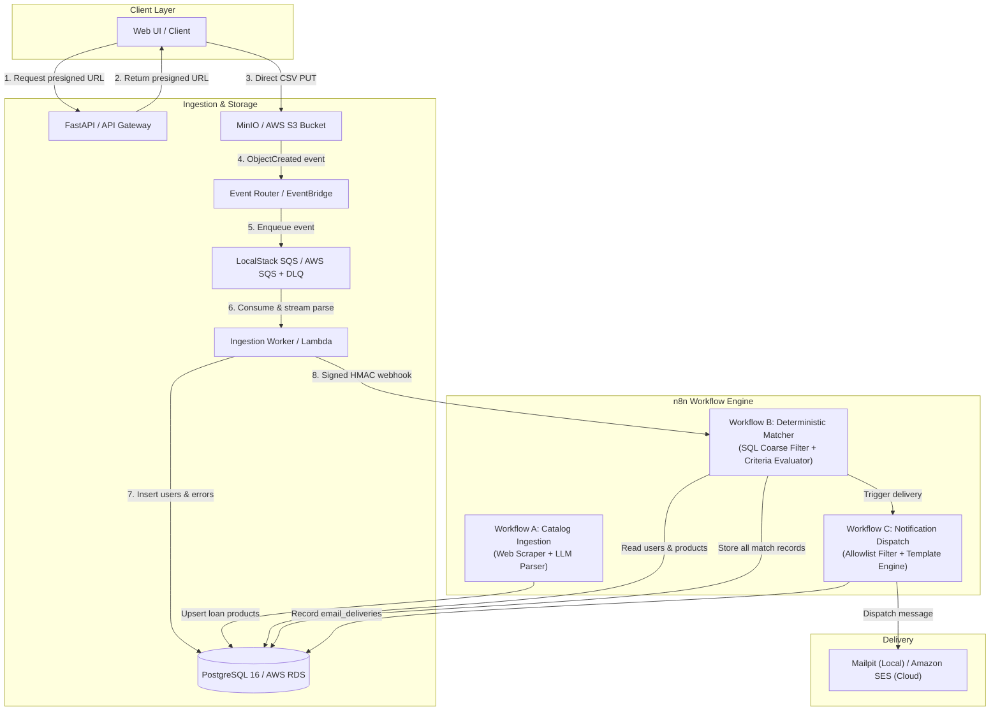

# 🏦 Loan Eligibility Engine

[](https://www.python.org/)
[](https://fastapi.tiangolo.com/)
[](https://www.postgresql.org/)
[](https://www.docker.com/)
[](https://n8n.io/)
[](https://aws.amazon.com/)
[](https://astral.sh/uv)
[](file:///c:/Loan%20Eligibility%20Engine/tests/backend)

A high-performance, event-driven loan eligibility engine and distributed matching pipeline. The engine processes high-volume customer CSVs via direct-to-storage presigned uploads, streams and validates records into PostgreSQL with strict idempotency, extracts real-time loan product criteria using an AI/LLM parser, executes deterministic matching via an optimized two-stage filter, and orchestrates personalized customer notification workflows through self-hosted [n8n](https://n8n.io/).

Engineered for dual-mode execution: a fully self-contained **10-service local stack** (Docker Compose, MinIO, LocalStack SQS, Mailpit, LLM stub) and an **AWS Serverless target architecture** (S3, EventBridge, SQS, Lambda, RDS PostgreSQL, SES).

---

## 📑 Table of Contents

- [Key Capabilities](#-key-capabilities)
- [System Architecture](#-system-architecture)
- [Tech Stack & Service Topology](#-tech-stack--service-topology)
- [Project Layout](#-project-layout)
- [Quick Start (Local Stack)](#-quick-start-local-stack)
- [End-to-End Walkthrough](#-end-to-end-walkthrough)
- [n8n Workflow Pipelines](#-n8n-workflow-pipelines)
- [Optimization & System Invariants](#-optimization--system-invariants)
- [REST API Reference](#-rest-api-reference)
- [Testing & Quality Assurance](#-testing--quality-assurance)
- [AWS Production Blueprint](#-aws-production-blueprint)

---

## ✨ Key Capabilities

* **Direct-to-Storage Presigned Uploads**: Decouples heavy file transfers from API instances. Clients request presigned URLs from FastAPI / API Gateway and stream files straight to S3 or MinIO.
* **Resilient Event-Driven Ingestion**: S3 `ObjectCreated` triggers dispatch through EventBridge / MinIO webhooks into an SQS FIFO/standard queue with dead-letter queue (DLQ) support and exponential backoff retry.
* **Streaming, Memory-Bounded CSV Ingestion**: Custom streaming parser reads large files in fixed chunks, strictly enforcing 7 required fields while isolating arbitrary custom columns into `raw_data` JSONB.
* **Dual-Stage Optimized Matching**:
  1. *SQL Coarse Filter*: Eliminates mathematically disqualified user-product combinations directly in PostgreSQL before orchestration.
  2. *Deterministic Rule Evaluator*: Evaluates full criteria in n8n, categorizing decisions into `eligible`, `ineligible`, and `may_qualify`.
* **Complete Persistence & Auditability**: Evaluates and persists 100% of candidate pairs. Presentation `TOP_K` limits only what customers see in notifications, never what is stored for regulatory compliance.
* **Automated Product Catalog & LLM Extraction**: Daily scheduled scraping of loan provider sites (Discover, SoFi, LightStream) with LLM-powered criteria extraction and schema validation.
* **Cryptographic Webhook Handoff**: Inter-service communication between workers and n8n webhooks is authenticated via canonical JSON HMAC-SHA256 signatures with replay protection.
* **Safe Multi-Channel Notifications**: Built-in email normalization, anti-header-injection sanitization, and strict recipient allowlisting (`DEMO_RECIPIENTS`) supporting Mailpit locally and Amazon SES in the cloud.

---

## 🏛 System Architecture

The engine provides parity between local development and production cloud deployment:



> [!NOTE]
> Explore the interactive architecture view in [docs/architecture.html](file:///c:/Loan%20Eligibility%20Engine/docs/architecture.html).

---

## 🧰 Tech Stack & Service Topology

| Domain | Local Development | AWS Production Blueprint | Details |
| :--- | :--- | :--- | :--- |
| **API & Web** | [FastAPI](file:///c:/Loan%20Eligibility%20Engine/backend/app/main.py) + [Nginx](file:///c:/Loan%20Eligibility%20Engine/web/nginx.conf) | AWS API Gateway + Lambda | Asynchronous REST endpoints on `:8000`, Web UI on `:8080` |
| **Object Storage** | MinIO (Port `:9000` / `:9001`) | Amazon S3 | Presigned upload targets; private, encrypted buckets |
| **Messaging** | Event-Router + LocalStack SQS (`:4566`) | Amazon EventBridge + SQS | Decoupled asynchronous event broker with DLQ |
| **Ingestion** | Python Ingestion Worker | AWS Lambda (VPC Attached) | Streaming chunked CSV parser, idempotent batch commits |
| **Database** | PostgreSQL 16 Alpine (`:15432` / `:5432`) | Amazon RDS PostgreSQL | Schema with relational constraints, JSONB indices, full audit logs |
| **Orchestration** | Self-hosted [n8n](file:///c:/Loan%20Eligibility%20Engine/n8n) (`:5678`) | EC2 / ECS n8n Container | Automated bootstrap, encrypted credentials, 3 core workflows |
| **Email Delivery** | Mailpit (`:8025` Web / `:1025` SMTP) | Amazon SES | Local capture UI vs. sandboxed high-volume cloud deliverability |
| **AI / LLM** | Offline LLM Stub (`:8090`) | OpenAI / Bedrock Compatible | Deterministic criteria extraction without runtime network cost |

---

## 📂 Project Layout

```text
.
├── backend/                  # Core FastAPI application & business logic
│   ├── app/
│   │   ├── config.py         # Pydantic settings & environment configuration
│   │   ├── csv_ingestion.py  # Streaming CSV parser & schema validation
│   │   ├── ingestion.py      # Batch ingestion coordinator
│   │   ├── matching.py       # Deterministic loan-product criteria matcher
│   │   ├── metrics.py        # Strict mathematical ingestion counters
│   │   ├── recipients.py     # RFC-compliant email normalizer & sanitization
│   │   └── webhooks.py       # HMAC-SHA256 payload signing utilities
│   └── pyproject.toml        # Dependency pins & uv packaging
├── n8n/                      # n8n workflow definitions
│   ├── 01-public-loan-catalog.json   # Workflow A: Catalog discovery & LLM extraction
│   ├── 02-ingestion-match.json       # Workflow B: Ingestion verification & matching
│   └── 03-email-delivery.json        # Workflow C: Controlled notification delivery
├── migrations/               # Database migrations
│   └── 001_initial.sql       # PostgreSQL schema (users, batches, products, matches, logs)
├── local/                    # Local environment orchestration & bootstrap
│   ├── event_router.py       # MinIO webhook to SQS event normalizer
│   ├── ingestion_worker.py   # SQS worker executing the streaming pipeline
│   ├── minio_bootstrap.py    # Bucket creation & notification provisioning
│   └── n8n-bootstrap.js      # Zero-touch n8n credential & workflow provisioner
├── llm_stub/                 # Deterministic local LLM server for criteria extraction
├── web/                      # Static client UI for uploading CSVs and monitoring progress
├── docker-compose.yml        # 10-container local stack definition
├── serverless.yml            # Production-ready AWS infrastructure-as-code blueprint
├── tests/                    # Pytest test suite & fixtures
└── docs/                     # Interactive diagrams & runbooks
```

---

## 🚀 Quick Start (Local Stack)

### Prerequisites

* [Python 3.12](https://www.python.org/) & [uv](https://docs.astral.sh/uv/)
* [Docker Desktop](https://www.docker.com/) (Compose v2)
* Node.js 22+ (optional, for inspecting Serverless definitions)

### 1. Clone & Configure

```bash
git clone https://github.com/your-username/loan-eligibility-engine.git
cd "loan-eligibility-engine"

# Create local environment config
cp .env.example .env

# Install backend dependencies
uv sync --project backend --group test
```

### 2. Launch Container Stack

Start the complete 10-service local development environment:

```bash
docker compose up --build
```

The stack automatically boots and provisions:
- PostgreSQL 16 on `localhost:15432` with all migrations applied.
- MinIO S3 on `http://localhost:9000` with the `loan-uploads` bucket.
- LocalStack SQS on `http://localhost:4566` with `loan-eligibility-events`.
- n8n on `http://localhost:5678` with Workflows A, B, and C pre-imported and credentials configured.
- Mailpit on `http://localhost:8025` for viewing dispatched emails.
- Web UI on `http://localhost:8080`.

---

## 🔄 End-to-End Walkthrough

You can test the entire pipeline using the Web UI at [http://localhost:8080](http://localhost:8080) or via the command line:

### 1. Request a Presigned Upload URL

```bash
curl -sS -X POST http://localhost:8000/uploads \
  -H "Content-Type: application/json" \
  -d '{"filename": "applicants.csv", "content_type": "text/csv"}'
```

Sample JSON response:
```json
{
  "upload_id": "b8f2d593-3d02-4bb3-96b6-b5ce9d75e01c",
  "upload_url": "http://minio:9000/loan-uploads/uploads/b8f2d593-3d02-4bb3-96b6-b5ce9d75e01c/applicants.csv?...",
  "object_key": "uploads/b8f2d593-3d02-4bb3-96b6-b5ce9d75e01c/applicants.csv",
  "expires_in_seconds": 900
}
```

### 2. Stream the Customer CSV

Create a valid applicant file conforming to the 7-column schema:

```csv
user_id,name,email,monthly_income,credit_score,employment_status,age
u-101,Ada Lovelace,demo@example.test,6500.00,740,employed,32
u-102,Charles Babbage,charles@example.test,2200.00,580,self-employed,45
```

Upload directly using the presigned URL:
```bash
curl -sS -X PUT "$UPLOAD_URL" \
  -H "Content-Type: text/csv" \
  --data-binary @applicants.csv
```

### 3. Trace Event Processing

1. **MinIO** detects the PUT event and fires an HTTP notification to `event-router` (`:8091`).
2. **Event Router** normalizes the event payload and posts to **LocalStack SQS** (`loan-eligibility-events`).
3. **Ingestion Worker** polls SQS, reads the CSV stream from MinIO, validates each row, and executes a batch insert into PostgreSQL `users`.
4. **Worker** builds a canonical JSON HMAC signature and posts to **n8n Workflow B** (`/webhook/loan-ingestion-completed`).
5. **Workflow B** verifies the signature, runs the SQL coarse filter, calculates deterministic criteria matches, and inserts into `matches`.
6. **Workflow C** aggregates eligible matches per customer, checks the `DEMO_RECIPIENTS` allowlist, and dispatches rich email notifications to **Mailpit**.

### 4. Inspect Results

- **Mailpit Web UI**: Open [http://localhost:8025](http://localhost:8025) to view personalized eligibility emails.
- **Upload Status**: Check batch metrics via `GET http://localhost:8000/uploads/{upload_id}`.
- **PostgreSQL**: Query `matches`, `users`, and `email_deliveries` at `localhost:15432`.

---

## ⚡ n8n Workflow Pipelines

The orchestration layer is decomposed into three autonomous workflows:

```text
┌────────────────────────────────────────────────────────────────────────┐
│                   Workflow A: Public Loan Catalog                      │
│  [Schedule / Manual] ──> [Scrape Web / Fixtures] ──> [LLM Extract]     │
│                              └──> [Validate Schema] ──> [Upsert DB]   │
└────────────────────────────────────────────────────────────────────────┘

┌────────────────────────────────────────────────────────────────────────┐
│               Workflow B: Deterministic Matching Engine                │
│  [HMAC Webhook] ──> [Verify Sig] ──> [Idempotency Gate]               │
│         └──> [SQL Coarse Filter] ──> [Deterministic Evaluator Code]    │
│                     └──> [Store Matches] ──> [Trigger Workflow C]     │
└────────────────────────────────────────────────────────────────────────┘

┌────────────────────────────────────────────────────────────────────────┐
│                 Workflow C: Grouped Email Delivery                     │
│  [Trigger from B] ──> [Group by User] ──> [DEMO_RECIPIENTS Allowlist]  │
│        ├── [Allowed] ──> [Mailpit / SES HTTP API] ──> [Log Delivery]   │
│        └── [Blocked] ──> [Record Blocked Status in DB]                 │
└────────────────────────────────────────────────────────────────────────┘
```

1. **Workflow A ([01-public-loan-catalog.json](file:///c:/Loan%20Eligibility%20Engine/n8n/01-public-loan-catalog.json))**:
   - Scrapes public personal loan landing pages (or reads local HTML fixtures when `LOAN_SOURCE_MODE=fixture`).
   - Uses the LLM extraction node to transform unstructured text into structured criteria schemas (`min_credit_score`, `min_monthly_income`, `employment_status`, `min_age`, `max_age`).
   - Upserts active records into `loan_products` with a SHA-256 content hash for auditability.

2. **Workflow B ([02-ingestion-match.json](file:///c:/Loan%20Eligibility%20Engine/n8n/02-ingestion-match.json))**:
   - Triggered by `users.ingestion.completed` webhook.
   - Verifies canonical HMAC-SHA256 signature and timestamp freshness (±300s).
   - Enforces event idempotency through `processed_events`.
   - Executes SQL coarse filtering to prune unmatchable candidate pairs.
   - Evaluates rules deterministically in JavaScript and commits records to `matches`.

3. **Workflow C ([03-email-delivery.json](file:///c:/Loan%20Eligibility%20Engine/n8n/03-email-delivery.json))**:
   - Groups multi-product eligibility records per customer.
   - Enforces a zero-trust allowlist (`DEMO_RECIPIENTS`): recipients not explicitly allowlisted are safely marked `blocked` in `email_deliveries` rather than dispatched.
   - Routes delivery to Mailpit locally or Amazon SES in production.

---

## 📐 Optimization & System Invariants

### 1. Two-Stage Coarse-to-Fine Filtering

In a naive implementation matching $U$ users against $P$ products, an engine would evaluate $U \times P$ combinations (e.g., $10,000 \times 10 = 100,000$ operations).

```text
naive_pairs = total_accepted_users × active_products
candidate_pairs = SQL_coarse_filter(users ⨉ products)
evaluated_pairs = candidate_pairs  (where candidate_pairs <= naive_pairs)
```

The engine applies a high-speed relational pre-filter directly in PostgreSQL (`SQL Coarse Filter`), pruning impossible pairs using index-backed comparisons before data reaches workflow memory.

### 2. Strict Partition Invariant

For every batch ingestion run, the engine validates that every row is accounted for mathematically:

$$\text{total\_rows} = \text{inserted\_rows} + \text{duplicate\_rows} + \text{invalid\_rows} + \text{failed\_rows}$$

$$\text{accepted\_rows} = \text{inserted\_rows} + \text{duplicate\_rows}$$

### 3. Replay Safety & Idempotency

- Stable composite primary key: `(upload_batch_id, source_row_number)` ensures replaying an identical SQS message or CSV never duplicates user records.
- Deterministic conflict handling: `matches` uses `ON CONFLICT (upload_batch_id, user_id, loan_product_id) DO UPDATE`.

---

## 🔌 REST API Reference

### `GET /health`
Verifies backend service availability.
```bash
curl -s http://localhost:8000/health
```
```json
{"status": "ok"}
```

### `POST /uploads`
Initiates a presigned file upload session.
```bash
curl -X POST http://localhost:8000/uploads \
  -H "Content-Type: application/json" \
  -d '{"filename": "customers.csv", "content_type": "text/csv"}'
```
```json
{
  "upload_id": "9b1deb4d-3b7d-4bad-9bdd-2b0d7b3dcb6d",
  "upload_url": "http://minio:9000/loan-uploads/uploads/9b1deb4d.../customers.csv?...",
  "object_key": "uploads/9b1deb4d.../customers.csv",
  "expires_in_seconds": 900
}
```

### `GET /uploads/{upload_id}`
Returns real-time ingestion status and row processing metrics.
```bash
curl -s http://localhost:8000/uploads/9b1deb4d-3b7d-4bad-9bdd-2b0d7b3dcb6d
```
```json
{
  "upload_id": "9b1deb4d-3b7d-4bad-9bdd-2b0d7b3dcb6d",
  "filename": "customers.csv",
  "status": "completed",
  "row_count": 10000,
  "error_count": 0,
  "created_at": "2026-11-17T08:00:00Z",
  "completed_at": "2026-11-17T08:00:14Z"
}
```

---

## 🧪 Testing & Quality Assurance

The test suite runs completely offline with zero external network or database dependencies using injected repository boundaries and mock storage adapters.

Run the test suite with `uv`:

```bash
uv run --project backend pytest tests/backend
```

### Test Coverage Highlights

* **[test_csv_ingestion.py](file:///c:/Loan%20Eligibility%20Engine/tests/backend/test_csv_ingestion.py)**: Validates chunked streaming parsing, extra column isolation into `raw_data`, and header schema verification.
* **[test_ingestion_service.py](file:///c:/Loan%20Eligibility%20Engine/tests/backend/test_ingestion_service.py)**: Verifies idempotency under re-ingestion and duplicate accounting.
* **[test_matching.py](file:///c:/Loan%20Eligibility%20Engine/tests/backend/test_matching.py)**: Tests deterministic rule evaluation, handling of unknown criteria, and decision boundaries (`eligible`, `ineligible`, `unknown`).
* **[test_api_and_webhook.py](file:///c:/Loan%20Eligibility%20Engine/tests/backend/test_api_and_webhook.py)**: Verifies presigned URL generation and canonical HMAC-SHA256 signature verification.
* **[test_metrics_and_recipients.py](file:///c:/Loan%20Eligibility%20Engine/tests/backend/test_metrics_and_recipients.py)**: Tests RFC recipient normalization and anti-CRLF header injection protections.

---

## ☁️ AWS Production Blueprint

The repository includes a comprehensive [serverless.yml](file:///c:/Loan%20Eligibility%20Engine/serverless.yml) specification designed for AWS deployment:

* **Amazon S3**: Private bucket with SSE-KMS encryption, strict bucket policies, and EventBridge notifications enabled.
* **Amazon EventBridge & SQS**: Filters `ObjectCreated` events, buffering them in an SQS queue with an attached Dead Letter Queue (DLQ).
* **AWS Lambda Ingestion Worker**: VPC-attached Lambda function with streaming S3 access, connecting securely to Amazon RDS PostgreSQL via private subnets.
* **AWS Secrets Manager**: Manages database credentials, n8n HMAC webhook secrets, and SES delivery keys with automatic rotation support.
* **Amazon SES**: Sandboxed or production-verified email dispatch with DKIM and SPF verification.

---

## 📄 License

This project is licensed under the MIT License — see the [LICENSE](LICENSE) file for details.
